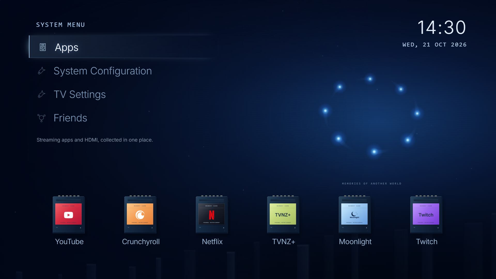

# TB for LG webOS

A remote-first home screen with memory-card app tiles, HDMI inputs, drifting blue lights and original console-inspired startup visuals.

Inspired by [Gathin's TV project and @gathint's post](https://github.com/Gathin23/cleanyourtv). The webOS foundation is [partridgeworks/webos-launcher](https://github.com/partridgeworks/webos-launcher), not a port of Gathin's Android Java launcher. Thanks to both projects, the webOS Homebrew community and [LG Input Hook](https://github.com/Simon34545/lginputhook).



## What it does

- Apps and HDMI inputs as memory cards, with show/hide and remote reordering.
- A six-item tray of recently launched visible apps or inputs, newest first.
- A clock, original blue scenery, optional user wallpaper and adjustable image fade.
- Eight blue lights with depth and trails. Animation work pauses when inactive or hidden.
- A quiet idle cycle: background to black, moving lights, full black, then time and wake text. First input wakes without launching an app.
- A handheld-style morning/afternoon/evening greeting or a tower-and-cloud startup. The rest of the home stays the same when switching startup styles.
- Independent menu and startup audio settings. **Console recordings are not included; startup audio defaults off.**
- Optional installed-app discovery and TV picture controls through an existing rooted Homebrew Channel installation.
- Optional Steam friends through a separately run, authenticated PC relay. No Steam credentials ship in the app.

## Compatibility and test status

Developed on an **LG OLED48C24LA**, firmware **23.25.55**, **webOS24 / SDK9.2.2**. The personal predecessor was installed and exercised on that TV, including remote navigation, apps/HDMI, Pinball discovery, picture settings and the idle view. This public **0.1.0** copy has a new app ID, neutral media and an explicit discovery switch. It is PC-build/browser tested and **has not yet been installed on the TV**. Other TVs and firmware are unverified.

The bundle targets Chrome79 as a compatibility baseline and uses a classic script for webOS file loading. That does not establish support for every older webOS TV.

## Build

Node22 and npm are recommended.

```sh
npm ci
npm test
npm run build
npm run package
```

The resulting package is `build/com.tb.weboslauncher_0.1.0_all.ipk`. Packaging is separate from installation and does not contact any TV. `npm run dev` previews the app on the PC with mock apps/inputs; picture controls use mock values there.

## Install and navigation

Install the built IPK with [webOS Dev Manager](https://github.com/webosbrew/dev-manager-desktop) or LG's CLI and your own paired device profile:

```sh
npx ares-install --device YOUR_TV build/com.tb.weboslauncher_0.1.0_all.ipk
npx ares-launch --device YOUR_TV com.tb.weboslauncher
```

Developer Mode is sufficient for the basic launcher and its known-app catalogue. Its normal session limitations apply. On a rooted TV, use your existing Homebrew installation workflow; do not install Developer Mode on top of root.

D-pad moves focus; OK opens/selects; Back returns or opens the system menu. In Apps & inputs, choose Applications or HDMI inputs, then Show/hide or Arrange. Arrange uses OK to pick up, arrows to move, OK to place; Back cancels a held move. Magic Remote pointer clicks also work.

The app does **not** automatically replace Home, remap Settings, install root, change privacy settings or remove apps. Rooted users can separately map Home to `com.tb.weboslauncher` with LG Input Hook. Cold-boot and standby-wake integration is firmware-specific and is not installed by this package. LG Home remains available from the menu.

## Optional root features

In Apps & inputs, **Homebrew: Off/On** opts into live installed-app discovery. Enable it only on your own rooted TV with Homebrew Channel. It runs fixed `listLaunchPoints` and validated icon-read commands through that service, retains known artwork and falls back to the catalogue when unavailable. App installation/uninstallation stays outside TB. New discoveries remain hidden until selected. Returning to TB, opening the chooser or selecting Refresh reads the list again.

TV Settings uses Homebrew Channel for bounded, validated picture-setting queries/changes and readback, scoped to the active input/profile. Root access is powerful; this feature is optional, has no remote command endpoint, and is not a substitute for checking settings on your own firmware. Open All LG settings if unavailable. A Settings-button hook is not installed here.

## Startup audio and personal images

All bundled scenery/intro visuals are original SVG, CSS or canvas. No anime image, Nintendo/Sony recording, extracted LG icon pack or personal screenshot is distributed.

To use your own appropriately licensed startup recordings, add `public/audio/gba-startup.wav` and/or `public/audio/ps2-startup-reference.wav`, rebuild, and enable the corresponding sound in System Configuration. The two filenames identify the corresponding visual style; you may supply any suitable WAV. Keep samples short: the greeting lasts4.4s and the tower intro5.2s. Audio readiness, cancellation and independent volume are handled by the app. Brand names describe inspiration, not endorsement.

Custom wallpapers are optional direct HTTP(S) URLs entered by the user. Use an image you have permission to display; a remote image host receives the normal image request. Do not enter secret-bearing URLs.

## Network and data behaviour

There is no analytics, ad service, account signup or automatic external content feed in TB. App choices, recent launches and preferences are stored in the app's localStorage. The only optional external requests from the UI are a user-entered wallpaper and Steam relay URL. The bearer relay token is saved locally on the TV; keep the relay on a trusted private network and do not expose it publicly. Native app launches, streaming apps, TV services and Homebrew have their own network behaviour.

The Steam relay in `scripts/steam-relay.mjs` is a separate Node process; it is not installed or auto-started by TB. It requires your own `STEAM_WEB_API_KEY`, `STEAM_ID` and random `STEAM_RELAY_TOKEN` environment variables. `STEAM_RELAY_HOST` defaults to loopback; LAN use requires choosing your own private address and restricting the firewall to your TV. The TV receives a friends snapshot, not the API key. The relay contacts Steam's API when requested and caches results. API-key/account setup and real-account integration are not part of the public release's test claims.

Phone mirroring is not implemented in TB. LG AirPlay/Miracast may be used separately; keep those services if you debloat your TV. No telemetry-disabling or microphone-blocking claim is made by this launcher.

## Tests and limitations

Local checks cover audio readiness/cancellation/cache, orbit bounds and recent-history ordering. Relay tests use synthetic accounts and API responses. Browser checks exercise the retro menu, startup choices, optional discovery control and picture-page fallback. Screenshots in `docs/` are PC previews, not photographs of a TV. Hardware testing of this public identity/assets remains pending; report your exact model/firmware in [issues](../../issues).

The idle design reduces stationary display time, but it is not a guarantee against OLED burn-in. Keep the TV's own panel protections enabled. Root/debloat tools and the experimental power watcher from the personal setup are intentionally not distributed.

## Licence and credits

Project code and original visuals: MIT; see [LICENSE](LICENSE). The original webOS launcher copyright/license is retained. [Third-party notices](THIRD_PARTY_NOTICES.md) cover Preact, Inter and CC0 Simple Icons. Logo names remain their owners' trademarks. This project is independent of LG, Sony, Nintendo and the streaming services.

Gathin's project supplied the inspiration; partridgeworks supplied the webOS starting point. [lewisdoesstuff/webos-nxe](https://github.com/lewisdoesstuff/webos-nxe) inspired exploring a console dashboard. TB's retro UI and integrations were developed with Codex; the public export keeps private configuration and owner media out of the repository.
